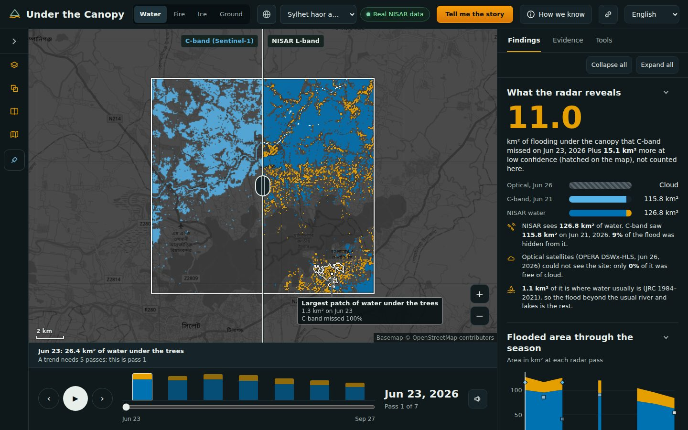
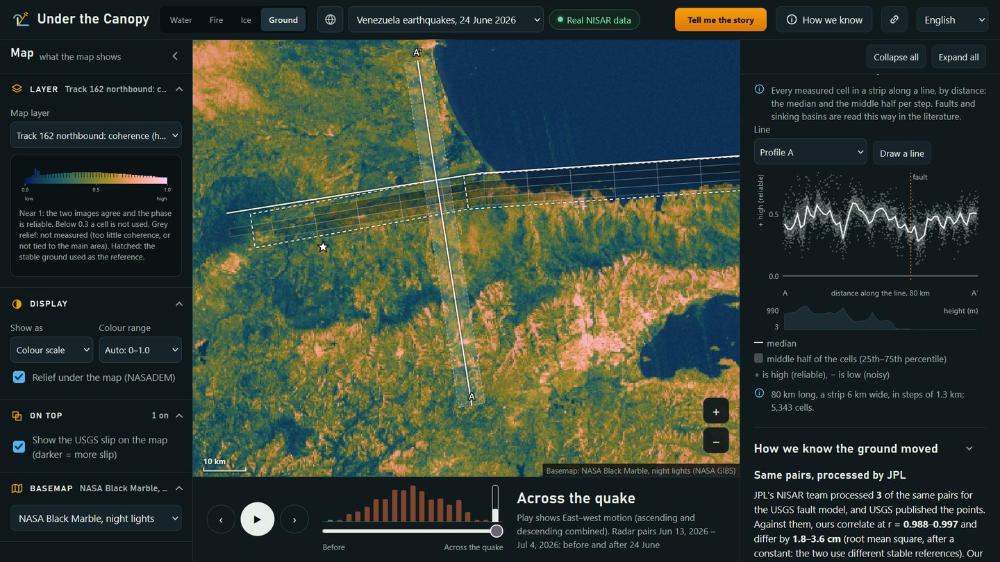
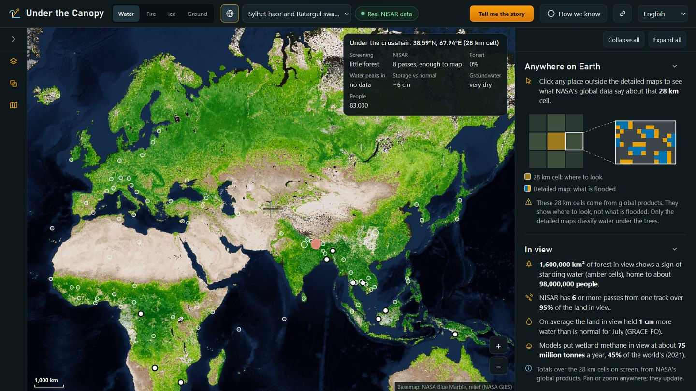
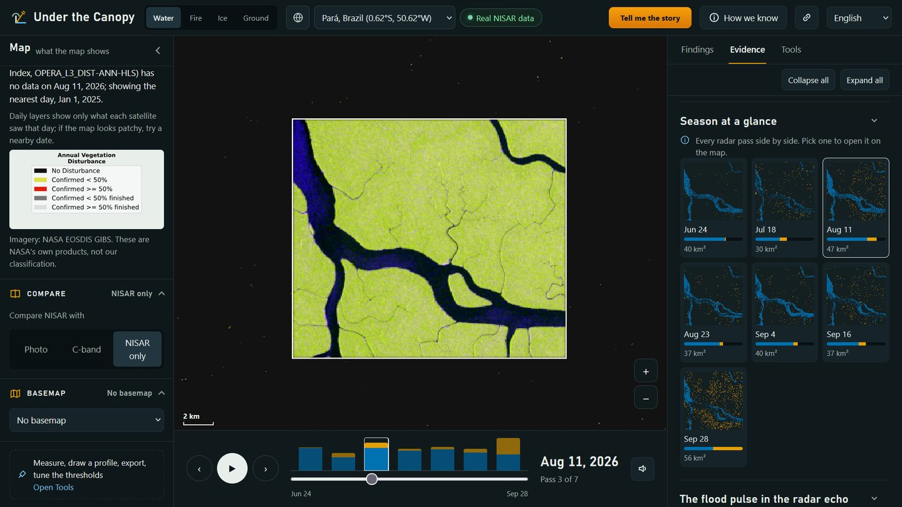
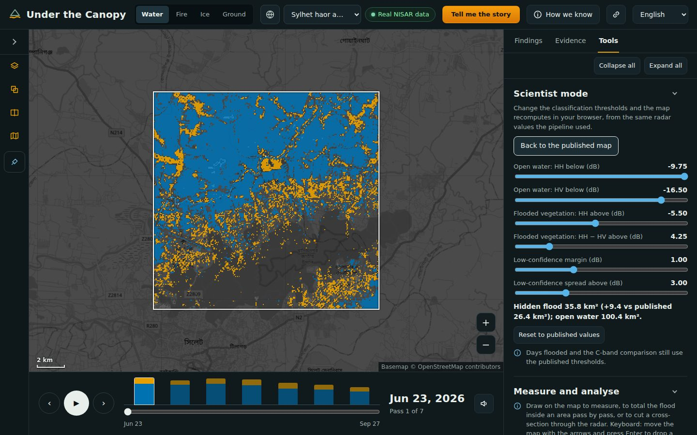
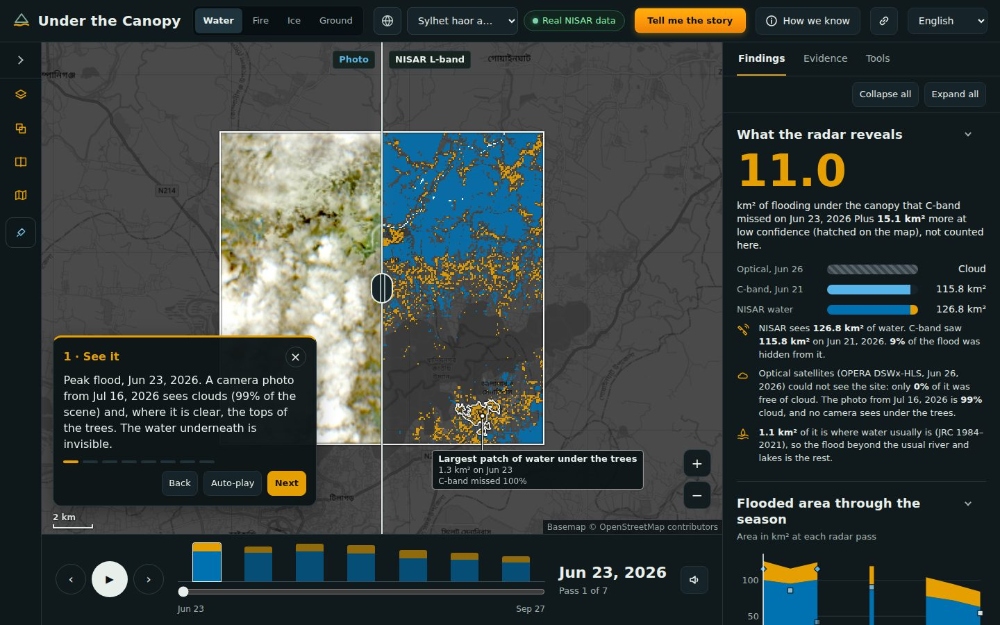
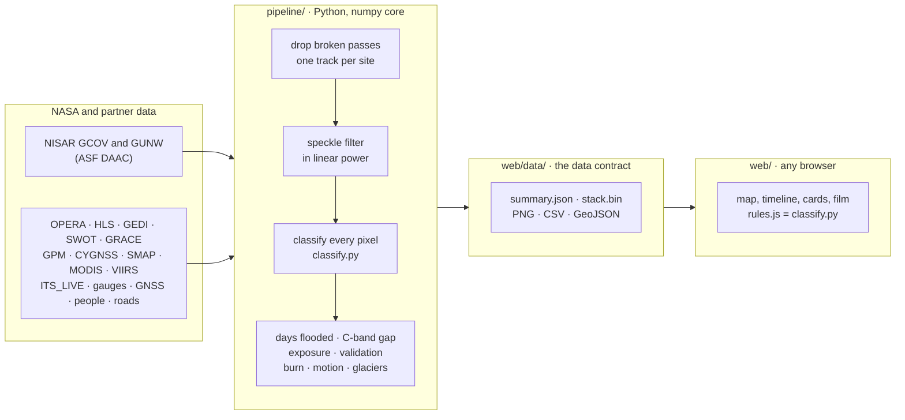

<div align="center">

<picture>
  <source media="(prefers-color-scheme: dark)" srcset="web/media/brand/mark.svg">
  
</picture>

# Under the Canopy

**The flood is under the trees. NISAR's L-band radar can see it.**

Water hidden in forests, forest burned under smoke, ground that moved and ice that flows,
mapped from real NASA-ISRO NISAR data, with every number checked against an independent measurement.

[](https://underthecanopynasaspaceappchallenge.vercel.app/landing.html)
[](LICENSE)


[**Open the live app**](https://underthecanopynasaspaceappchallenge.vercel.app/landing.html) ·
[**Watch the 30-second film**](web/media/pitch30-en-vo-clone-subtitled.mp4) ·
[**Run it locally**](#quick-start) ·
[**Data credits**](CREDITS.md)



<sub>Sylhet, Bangladesh, 23 June 2026. Left: what C-band radar saw. Right: NISAR. <b>Amber</b> is water standing under the trees: 26.4 km², of which C-band missed 11.0 km². The camera saw only cloud.</sub>

</div>

> [!NOTE]
> An entry to the **2026 NASA International Space Apps Challenge**, *Dancing with the SARs*. Every result comes from real NISAR products (L2 GCOV and GUNW, provisional release, June to October 2026) and sits beside an independent check. Simulated demo data are always badged **SYNTHETIC**. Not endorsed by NASA, ISRO or any data provider.

<details>
<summary><b>Contents</b></summary>

- [The problem](#the-problem)
- [How NISAR sees it](#how-nisar-sees-it)
- [Four kinds of change](#four-kinds-of-change)
- [What we found, and how we know](#what-we-found-and-how-we-know)
- [Who it is for](#who-it-is-for)
- [Everything inside the app](#everything-inside-the-app)
- [Quick start](#quick-start)
- [How it is built](#how-it-is-built)
- [Project structure](#project-structure)
- [Testing](#testing)
- [Rebuilding the data, notebooks and film](#rebuilding-the-data-notebooks-and-film)
- [Honest limits](#honest-limits)
- [Team](#team)
- [Use of AI tools](#use-of-ai-tools)
- [Licence, data and credits](#licence-data-and-credits)

</details>

---

## The problem

In swamp forests, river floodplains and mangroves, flood water can stand under the trees for months, right next to people's homes. Most flood maps cannot see it:

| | What it sees at Sylhet in June 2026 |
|---|---|
| **A camera from space** | 99 % cloud. Nothing. |
| **Most satellite radar** (C-band, 5.6 cm waves) | 115.8 km² of open water. Its waves scatter in the leaves, so the forest looks dry. |
| **NISAR** (L-band, 24 cm waves) | 126.8 km², including **26.4 km² of water under the trees**. |

About **318,000 people** live within 1 km of that hidden water, and 334 km of roads run under it. In 2022, floods in this region affected 7.2 million people (IFRC), and many warnings came late or never came.

## How NISAR sees it

NISAR's L-band waves are about 24 cm long. They pass the leaves, reflect off the water surface, strike a tree trunk and return to the satellite. This **double bounce** makes flooded forest shine in the radar image.

The rule that sorts every pixel of every pass, in one line:

- **open water** where HH and HV are both very dark;
- **water under the trees** where the land is vegetated, HH is bright *and* HH − HV is large (the double bounce);
- built-up land is excluded, and pixels near a threshold are hatched as **low confidence**.

The thresholds come from published L-band studies and are calibrated per site on labels from independent maps. A calibration that makes the river-gauge agreement worse is rejected. The rule is the same in Python ([`pipeline/canopy/classify.py`](pipeline/canopy/classify.py)) and in the browser ([`web/src/rules.js`](web/src/rules.js)), tested to give identical results.

Because NISAR passes every 12 days, the app shows **change over time**. At Sylhet the open water drained from 100 to 63 km² over the season, while the water under the trees held at 21 to 26 km²: the river drained, but the forest stayed flooded, in places for **108 days**.

## Four kinds of change

The same radar, method and honesty cover four kinds of surface change.

| | Change | Headline | Why it matters | Who gains |
|---|---|---|---|---|
| 💧 | **Water under the trees** | 26.4 km² hidden at Sylhet; 27 flood sites mapped, plus a replay of the January 2026 Limpopo flood in Mozambique | Villages sit at the forest edge, and flooded wetlands are the largest natural source of methane | Relief teams, local offices, methane and wetland scientists |
| 🔥 | **Forest burned through smoke** | 1,879 km² at Ontario's Thunder Bay 36 fire, dated pass by pass; Bald Range fire, British Columbia | Smoke hides a burn for weeks; radar maps it early, for recovery and carbon accounts | Forest services, fire scientists, carbon inventories |
| 🌍 | **Ground that moved** | Up to about 70 cm west in Venezuela's M7.5 earthquake (24 June 2026); parts of Mexico City sinking about 30 cm a year | Shows which fault slipped and which streets sink, before cracks reach pipes and homes | Seismologists, engineers, city planners |
| 🧊 | **Ice that flows** | A 28-glacier atlas since 1985; Greenland's Sermeq Kujalleq at up to about 36 m a day; wildfire smoke over the Columbia Icefield | Fast glaciers raise sea level, and soot from fires darkens ice so it melts faster | Glaciologists, sea-level planners, teachers |

<table>
<tr>
<td width="50%"></td>
<td width="50%"></td>
</tr>
<tr>
<td align="center"><sub><b>Ground that moved.</b> The Venezuela quake, a profile across the fault, and the checks against JPL.</sub></td>
<td align="center"><sub><b>Anywhere on Earth.</b> A 28 km world grid: where hidden floods are likely, NISAR coverage, water storage, people.</sub></td>
</tr>
</table>

## What we found, and how we know

A result counts only when something independent agrees with it. The checks are kept apart from the tuning.

| Change | Finding | Independent check |
|---|---|---|
| Water, Sylhet (Bangladesh) | 26.4 km² under the trees on 23 Jun 2026; 11.0 km² missed by C-band; up to 108 days flooded | River gauge (BWDB, Surma at Sylhet) **r = 0.94** over 7 passes; NASA SWOT water surface **r = 0.96** over 6 overpasses |
| Water, Janauacá and Mamirauá (Brazil) | up to 13.6 and 14.9 km² missed by C-band on a single pass | River gauges **r = 0.99** at both |
| Water, Atchafalaya (USA) | flooded forest tracked through the spring high water | USGS gauge **r = 0.92** |
| Water, Pantanal (Brazil) | almost no water under trees this season | gauge **r = −0.02**: reported, not hidden |
| Fire, Thunder Bay 36 (Canada) | 1,879 km² of forest burned | NASA MODIS MCD64A1: 1,830 km²; agreement **F1 = 0.85**, and 0.85 on the half of the area the rule was not tuned on; 94 % of patches dated within the VIIRS window |
| Earthquake, Venezuela | up to about 70 cm west on the coast south of the fault | JPL's own processing of the same NISAR pairs, **r = 0.988 to 0.997**; USGS finite-fault model forward-modelled with Okada (1985) |
| Subsidence, Mexico City | the fastest 1 % sinking 30 cm a year or more | GNSS station MMX1, same months: **27.6 cm/yr** (NISAR 24.1) |
| Ice, 28 glaciers | flow, trends and seasonal swing since 1985 | NASA ITS_LIVE; NISAR's own ice offsets tested beside it |
| A surprise we report | burned forest looks like flooded forest to the flood rule | 91 % of the post-fire "flood" at Thunder Bay lay inside the burn; the map flags it |

<p align="center"></p>

## Who it is for

| Audience | Their question | What they get |
|---|---|---|
| **Disaster and relief teams** | Which villages by the forest need boats this week? | A printable **village flood card** per pass: settlements beside hidden water, roads under it, people within 1 km, when NISAR passes next |
| **Communities and local offices** | Is the forest by my village flooded, and for how long? | The whole app in **Bengali, Portuguese and English**; tap any spot for its days flooded; **label mode** to mark what you know |
| **Radar and water scientists** | Are the thresholds right, and can I reuse the data? | **Scientist mode** (move any threshold, the map recomputes exactly as the pipeline does); GeoTIFF, GeoJSON and CSV for every pass |
| **Climate and methane modellers** | How much wetland is really flooded, and for how long? | Days flooded under forest, a **methane ledger** shown as a range, and the tropical flooded-forest belt |
| **Students and teachers** | How can a satellite see water I cannot? | A game ([`play.html`](web/play.html)), a guided story, and **59 Colab notebooks** that start from first principles |
| **Planners, funders and press** | What would a radar record add to flood and fire response? | Four changes explained the same way, an opening film, links to any view, and every source cited |

> [!IMPORTANT]
> The flood card is **not a warning system**. NISAR's maps arrive days after a pass, so they are for planning relief and checking where water hides. The card says so itself.

## Everything inside the app

<table>
<tr>
<td width="50%"></td>
<td width="50%"></td>
</tr>
<tr>
<td align="center"><sub>Scientist mode: move the thresholds yourself.</sub></td>
<td align="center"><sub>The guided story: the finding in three chapters.</sub></td>
</tr>
</table>

| Group | Features |
|---|---|
| **Explore** | photo → C-band → NISAR swipe · explain any pixel · map notes on the key feature · season at a glance · days flooded · water-level change under the trees (interferometry) · GEDI canopy height · anywhere on Earth · "what's here" readout · NASA GIBS live layers · active fires (FIRMS) · floods reported now (GDACS) · satellite tracks and the next NISAR pass |
| **Analyse** | scientist mode · radar feature space · flood-pulse ridges · where the water went (alluvial flows) · patch tracking · omnibus change test · Mann–Kendall trend test · river-gauge check · rain, L-band water and soil-moisture drivers · "is this a wet year?" (GRACE) · two-week outlook (experimental) · measure, area statistics, cross-sections |
| **Fire · Ground · Ice** | burned area against MODIS and VIIRS · fires between radar passes · smoke on downwind ice · earthquake rupture replay · profiles against the USGS model · GNSS checks · glacier atlas with flow particles · time–distance diagrams · GRACE ice mass |
| **Make it felt** | the **village flood card** · **find the hidden water** game · **Earth's waltz** (each season played in 3/4, a clashing note where C-band missed water) and a radar poster · hear the flood pulse · the **methane ledger** · an opening film rendered from the data |
| **Share and learn** | GeoTIFF, GeoJSON, CSV downloads · links that reopen any view · three languages · label mode · "How we know" field guide · sources page (54 sources) · 59 notebooks · analyse a new place (local server) · works offline |

## Quick start

You need **Python 3.11+** and a browser. The published data are already in [`web/data/`](web/data/), so no NASA account is needed.

```bash
git clone https://github.com/memset2020/under_the_canopy_NASA_SPACE_APP_CHALLENGE.git
cd under_the_canopy_NASA_SPACE_APP_CHALLENGE/pipeline
pip install -e ".[dev]"
python cli.py serve --port 8090        # then open http://127.0.0.1:8090
```

| Also try | |
|---|---|
| `http://127.0.0.1:8090/landing.html` | the landing page and opening film |
| `…/index.html?site=sylhet` | straight to the Sylhet map |
| `…/index.html?site=sylhet&basemap=off` | no network at all: the app still works |
| `…/index.html?site=janauaca&lang=pt` | Lago Janauacá in Portuguese |
| `…/play.html` | the "find the hidden water" game |
| `./run.sh` (macOS, Linux, WSL) | starts the server and opens the browser |
| `cd web && python -m http.server 8000` | the static site alone, without the pipeline |

> [!TIP]
> On Windows, install Python from python.org and set `$env:PYTHONUTF8 = "1"` before running the CLI. `python cli.py serve` also enables **Analyse here**, which builds a new detailed site for a place you pick (it needs a free [NASA Earthdata Login](https://urs.earthdata.nasa.gov/) in `~/.netrc`).

## How it is built



1. **NASA data in.** [`pipeline/`](pipeline/) reads only the parts of each NISAR file that cover a site, through Earthdata Login, plus OPERA DSWx and RTC, HLS, NASADEM, GEDI, SWOT, GRACE/GRACE-FO, GPM IMERG, CYGNSS, SMAP, ICESat-2, MODIS, VIIRS, ITS_LIVE, WetCHARTs and SEDAC, with partner data (ESA WorldCover, Copernicus DEM, JRC surface water, USGS, GNSS, WorldPop, OpenStreetMap).
2. **Physics, not a black box.** Published radar rules classify every pixel of every pass. Interferometric phase becomes centimetres of motion, with the ionosphere removed and low-coherence pixels masked. The earthquake is compared with the USGS fault model through Okada's (1985) equations, implemented in [`pipeline/canopy/okada.py`](pipeline/canopy/okada.py).
3. **Checked apart from the tuning.** River gauges, NASA SWOT and MODIS, JPL's processing, the USGS model and GNSS stations.
4. **An open map out.** [`web/`](web/) is plain ES modules with **no framework and no runtime dependencies**. It reads only [`web/data/`](web/data/), whose format is defined by JSON schemas in [`pipeline/schema/`](pipeline/schema/), runs offline, and needs no account.

## Project structure

```
.
├── pipeline/                 Python: satellite files → web/data/
│   ├── cli.py                all · fetch · calibrate · global · belt · motion · ice · glaciers · events · serve · inspect
│   ├── canopy/               classify.py (the rule) · burn.py · motion.py · okada.py · glaciers.py · exposure.py · validate.py · serve.py …
│   ├── config/               sites.json · calibration/ · glaciers.json · motion.json · ice.json
│   ├── schema/               JSON schemas of the data contract
│   └── tests/                pytest: science, contract, published files
├── web/                      the app: static, no build step, no framework
│   ├── landing.html          landing page + opening film     index.html · play.html · sources.html · film.html
│   ├── src/                  one ES module per feature (rules.js mirrors classify.py)
│   ├── styles/               one stylesheet per page
│   ├── i18n/                 en.json · bn.json · pt.json
│   ├── data/                 published real data (committed)
│   ├── media/                screenshots, films (intro-*, pitch30-*), brand marks
│   ├── tools/film/           render.mjs · score.py · voice.py · clone.py (the film is code, not footage)
│   └── tests/                unit (node --test) and end-to-end (Playwright)
├── notebooks/                the NISAR ML tutorial, per-place notebook motifs and build script
├── .github/workflows/        CI · GitHub Pages · belt batch mapping
├── CREDITS.md                every data source, its licence and citation
├── LICENSE · NOTICE          Apache License 2.0
└── run.sh                    start the local server and open the browser
```

## Testing

```bash
cd pipeline && pytest -q                                      # science, data contract, published files
cd web && npm install && node --test "tests/unit/*.test.js"   # rules.js parity, maths, i18n keys, film timing
npx playwright install chromium && npx playwright test        # end-to-end in a real browser
```

About 160 Python tests and 230 JavaScript tests. A parity fixture written by pytest proves the browser and the pipeline classify every pixel identically. CI ([`.github/workflows/ci.yml`](.github/workflows/ci.yml)) runs lint, pytest on Python 3.11 and 3.12, the unit tests and Playwright.

## Rebuilding the data, notebooks and film

<details>
<summary><b>Rebuild a site from NASA archives</b> (needs a free Earthdata Login)</summary>

```bash
cd pipeline
pip install -e ".[real]"
python cli.py fetch --site atchafalaya --coverage          # which NISAR passes exist
python cli.py fetch --site atchafalaya --gcov --worldcover --dswx --osm --gauge
python cli.py all --site atchafalaya                       # build web/data/atchafalaya/
python cli.py all --synthetic                              # the offline simulator (no account)
```

The flooded-forest belt is mapped in parallel on GitHub Actions at no cost ([`.github/workflows/belt.yml`](.github/workflows/belt.yml)).
</details>

<details>
<summary><b>Rebuild the notebooks</b></summary>

```bash
python notebooks/build_notebooks.py        # builds and runs every notebook; --kind / --site to narrow
python notebooks/sync_to_drive.py          # publishes to Google Drive, writes web/data/notebooks.json
```

Start with the tutorial: [`notebooks/under_the_canopy_nisar_ml_tutorial.ipynb`](notebooks/under_the_canopy_nisar_ml_tutorial.ipynb). It goes from radar physics to the decision space, L-band against C-band, the river-gauge check, threshold sensitivity and an honest machine-learning comparison.
</details>

<details>
<summary><b>Render the films</b> (needs Node, Python with numpy, and ffmpeg with libx264)</summary>

[`web/film.html`](web/film.html) draws the film from `web/data` as a pure function of time. [`web/tools/film/render.mjs`](web/tools/film/render.mjs) steps it frame by frame in headless Chromium, and [`score.py`](web/tools/film/score.py) synthesises the soundtrack from the film's own cues.

```bash
cd web
FFMPEG=/path/to/ffmpeg node tools/film/render.mjs --lang en                # opening film, 2 min 29 s
FFMPEG=/path/to/ffmpeg node tools/film/render.mjs --lang en --cut short    # the 30-second demo
node tools/film/render.mjs --stills 5,20,40 --out /tmp/check.mp4           # check frames without encoding
```

Preview in the browser: `film.html?cut=short`, `?lang=bn`, `?aspect=portrait`. Narration is added by [`voice.py`](web/tools/film/voice.py), from lines made by [`clone.py`](web/tools/film/clone.py) (see [Use of AI tools](#use-of-ai-tools)).

| File in [`web/media/`](web/media/) | What it is |
|---|---|
| `pitch30-en-vo-clone-subtitled.mp4` | the 30-second Space Apps demo (29.8 s): narrated, English subtitles burned in |
| `pitch30-en-vo-clone.mp4` + `.vtt` | the same, with captions as a separate file |
| `intro-en-vo-clone.mp4` + `.vtt` | the 2 min 29 s opening film on the landing page, narrated |
| `intro-{bn,pt}.mp4`, `*-portrait.mp4` | Bengali and Portuguese films, and phone versions |
</details>

## Honest limits

- Thresholds start from published L-band studies and are calibrated per site on a few labelled points, not trained on ground truth.
- Very dense, tall canopy can still hide water, and flood under sparse shrubs can look dry. Both show as **low confidence** (hatched).
- Built-up areas are excluded: buildings mimic the double bounce.
- **Burned forest reads as flooded forest** to the flood rule (91 % of the post-fire "flood" at Thunder Bay); the map flags it.
- Near Caracas airport, our earthquake map and the USGS model differ by about 41 cm. The app shows both.
- The 12-day repeat can miss short flash floods. **This is not a warning system.**
- Gauge agreement shows the timing is right, not every pixel. Population figures are WorldPop model estimates, not a census.
- NISAR data are a first, provisional release.

## Team

| | Role | In the architecture |
|---|---|---|
| **Sakib Khandaker** | Research and science lead | Every threshold in `classify.py` and every check in the Evidence view starts from this research |
| **Faiyaz Ur Rahman** | Data pipeline and backend | Turns the research into files: everything the browser reads comes out of `pipeline/` |
| **Mehadi Hasan** | Core frontend and maps | Reads `web/data` and draws it: where the data contract becomes something you can click |
| **Fabiha Nusrat** | Experience, story and outreach | Shapes how a first-time visitor, a judge or a village office meets the findings |

## Use of AI tools

In line with the Space Apps rules on AI tools:

- **Code:** written with an AI coding assistant (Claude, Anthropic). Commits carry a `Co-Authored-By` line.
- **Narration:** the English voice in the films is AI-synthesised speech, a Chatterbox clone of our narrator's own voice, made with consent. The captions end with "[Narration: AI voice clone of our narrator]", and the MP4 metadata says so.
- **Animation:** the films are rendered frame by frame from the data by code written with AI assistance. The title card says so.
- **Translations:** the Bengali and Portuguese text are AI drafts, marked "Draft translation" in the app until a native speaker signs them off.
- **Not used:** no AI image generation, no AI-generated data, and no NASA logos or branding generated or modified.

## Licence, data and credits

The code is licensed under the [Apache License 2.0](LICENSE) (see [NOTICE](NOTICE)). The data keep their own licences: every source, its licence and the citation it asks for are in [CREDITS.md](CREDITS.md) and on the app's sources page (54 sources).

NISAR is a joint NASA-ISRO mission; data via the Alaska Satellite Facility DAAC. Other NASA data: OPERA DSWx and RTC, HLS, NASADEM, GEDI, LBA-ECO, SWOT, GRACE/GRACE-FO, GPM IMERG, CYGNSS, SMAP, ICESat-2, MODIS, VIIRS, ITS_LIVE, WetCHARTs, SEDAC and GIBS. Partner and other data: ESA WorldCover, Copernicus DEM and GLO-30 HAND, JRC Global Surface Water, GLWD v2, Randolph Glacier Inventory 7.0, USGS (gauges and earthquakes), ANA, BWDB FFWC, Nevada Geodetic Laboratory GNSS, GDACS, GEOGloWS, WorldPop, GeoNames, and © OpenStreetMap contributors. Challenge image: NASA/JPL-Caltech, PIA26672.

Under the Canopy is an independent entry to the 2026 NASA International Space Apps Challenge. It is **not endorsed by NASA, ISRO or any data provider**.

<div align="center">
<sub>Made for the people who live at the forest's edge, and for everyone learning what radar can see.</sub>
</div>
